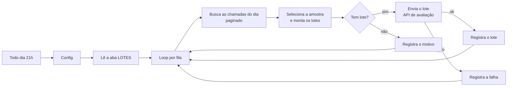

# Amostragem para avaliação de qualidade por IA (n8n)

Workflow n8n que escolhe, todo dia, **quais ligações vão para a avaliação de qualidade por IA**: os detratores
sempre entram, e as demais são sorteadas até um teto diário de minutos de áudio.

> Versão genérica de um fluxo em produção numa operação de atendimento. Não tem dado, id nem credencial do cliente:
> URLs, filas, agentes e ligações são de exemplo.

## O problema

A API de avaliação analisa a gravação contra um critério (abertura, segurança, solução, encerramento...) e cobra
por minuto de áudio. O contrato tem um teto mensal de minutos.

| Situação | O que dava errado |
|---|---|
| Avaliar todas as ligações | Daria cerca de **3 vezes** o teto mensal |
| Avaliar só os detratores | Cabe com folga (cerca de 1/5 do teto), mas a amostra fica enviesada: só ligação ruim |
| A pesquisa (NPS/CSAT) é respondida depois que o agente sai da linha | Não vem no webhook de fim de chamada |
| Transferência | A mesma gravação aparece em duas pernas do relatório |
| Um telefone vazio ou `"0"` no lote | A API recusa o **lote inteiro** |
| Rodar o mesmo dia de novo | Análise e cobrança em dobro |

## Como funciona



Roda às 21h, depois do fim do expediente, com as ligações do **próprio dia**: a essa hora o relatório da telefonia já
traz a pesquisa, a gravação e o protocolo de cada ligação.

### A amostra, fila a fila

1. **Elegíveis:** receptivas, atendidas, acima da duração mínima e com gravação. Se a gravação aparece em duas pernas,
   fica a última, que é onde cai a pesquisa.
2. **Detratores entram sempre:** NPS até 6 **ou** CSAT "Insatisfeito". Os neutros (NPS 7 e 8) entram se ligados no
   Config.
3. **Sorteio até o teto:** as demais ligações são sorteadas até `minutosDia`, dividido igualmente entre as filas. Os
   detratores contam no teto, e entram mesmo que passem dele.
4. **Lotes:** até `loteMax` ligações por lote, cada uma com `metadata` (id da chamada, protocolo, gravação, agente,
   NPS, CSAT e por que entrou: `detrator`, `neutro` ou `sorteio`). É a chave para voltar da avaliação para a telefonia.

Com `minutosDia: 0`, o fluxo manda só os detratores.

### O sorteio é estável

Cada ligação recebe uma nota pseudoaleatória calculada a partir de `semente + dia + fila + id da chamada`, e o
sorteio segue essa ordem. Na prática:

- **Reprocessar o dia sorteia as mesmas ligações**, e dá para auditar por que uma ligação entrou.
- **Uma ligação a mais no relatório não embaralha as outras:** ela só ocupa a posição dela na fila do sorteio.
- **Ninguém prevê o sorteio sem a `semente`**, que fica no Config.

O sorteio **para na primeira ligação que não cabe** no teto, em vez de pular para a próxima. Pular encheria o teto
um pouco mais, mas favoreceria as ligações curtas. Nos testes, a duração média da amostra fica a menos de 10% da
média do dia.

## Armadilhas que o fluxo já trata

- **Telefone vazio derruba o lote inteiro.** A API valida o telefone de cada item e recusa o lote todo se um vier
  vazio ou `"0"`. A ligação sem telefone válido fica de fora e é contada em `semTelefone`.
- **Campos indexados sem buraco.** O lote é `phone_number_0`, `agent_0`, `audioUrls_0`... A numeração é refeita
  depois de filtrar, para não pular índice.
- **O token da gravação vai na URL do áudio.** A API baixa o áudio pelo link da telefonia, então o token precisa ir
  junto. O *Seleciona Amostra* grava só um marcador, e o *Envia Lote* troca pelo token na hora do envio. Assim, o
  token fica fora da planilha e da saída que monta o lote. O workflow também não salva execuções com sucesso: o
  histórico fica na aba `LOTES`.
- **Envio sem retry.** Repetir um POST que deu timeout pode criar o lote duas vezes, e cobrar duas vezes. A falha
  vira uma linha `erro` na aba. Antes de reprocessar, confira no painel se o lote não entrou.
- **Reenvio por ligação, não por dia.** Antes de enviar, o fluxo lê a aba `LOTES` e tira as ligações que a API já
  aceitou naquele dia e fila. Se um dia teve dois lotes e um falhou, reprocessar manda só o que faltou.
- **A aba vazia não pode parar o fluxo.** O *Lê Lotes* tem *Always Output Data* ligado. Sem isso, a primeira
  execução, com a aba ainda vazia, terminaria sem fazer nada.
- **O relatório é paginado** (50 por página). O *Busca Chamadas* segue as páginas até `next_url` vir vazio.

## Resultado em produção

Antes, o fluxo mandava só os detratores, cerca de 25 ligações por dia. No primeiro dia com a amostra ampliada,
foram **150 ligações** (12 detratores e 138 sorteadas) e **883 dos 900 minutos** do teto.

A aba `LOTES` mostrou que cerca de 20% das avaliações falhavam com "áudio mudo". Medi o volume das gravações: as
reprovadas tinham volume médio abaixo de **−30 dB**, por causa de trechos longos de espera e transferência, e só uma
era muda de verdade. O problema era um falso positivo do detector da API, não da integração.

Esta versão traz duas mudanças em relação ao fluxo em produção: o sorteio estável (lá é `Math.random`) e o reenvio
controlado por ligação (lá é por dia).

## Estrutura

```text
workflows/amostragem-diaria.json   o fluxo, com notas explicativas no canvas
scripts/criar_criterio.py          cria o critério e os subcritérios na API, sem duplicar
scripts/criterio.exemplo.json      critério de exemplo para atendimento receptivo
exemplos/                          página do relatório, lote montado e resposta da API (fictícios)
sandbox/                           roda os nós Code fora do n8n e gera dias fictícios
test/                              testes da amostra e checagens do JSON
```

## Como usar

1. **Critério na API.** Copie `.env.example` para `.env` e preencha. Rode o script primeiro sem `--criar`, para ver
   o que ele faria, e depois com `--criar`. Anote o `criteriaId`.

   ```bash
   python3 scripts/criar_criterio.py scripts/criterio.exemplo.json
   python3 scripts/criar_criterio.py scripts/criterio.exemplo.json --criar
   ```

   A API aceita no máximo 255 caracteres em `ideal_phrase`. Por isso, o que o avaliador deve conferir vai em
   `avaliar`, e o script põe essa lista na `description`, que não tem limite. O script valida o JSON inteiro antes do
   primeiro POST.

2. **Planilha.** Crie uma aba `LOTES` com este cabeçalho na linha 1:

   `timestamp` · `dia` · `fila_id` · `fila` · `criteria_id` · `elegiveis` · `com_pesquisa` · `itens` · `detratores` · `neutros` · `sorteadas` · `minutos` · `status` · `lote_id` · `files_count` · `erro` · `call_ids`

3. **n8n.** Faça *Import from File* do `workflows/amostragem-diaria.json` e selecione as credenciais:
   - Google Sheets nos quatro nós da planilha;
   - **Header Auth** da telefonia no *Busca Chamadas*;
   - **Header Auth** da API de avaliação (header `api_token`) no *Envia Lote*.

4. **Config.** Preencha as URLs, o `planilhaId`, as filas, o `criteriaId`, o `minutosDia`, a `semente` e o
   `tokenGravacao`.

5. **Primeiro teste.** Ponha um dia recente em `dataReprocesso` e rode o *Reprocessar (manual)*. Depois confira:
   - na aba `LOTES`, `files_count` igual a `itens` (status `ok`);
   - no painel da API, as avaliações aparecendo.

   Depois, limpe o `dataReprocesso` e ative o workflow.

Para entender o volume antes de ligar, rode `npm run simular -- --minutos 900`. Ele mostra, para dias fictícios, quantas
ligações e minutos iriam por fila.

## Testes

Requer Node 18 ou mais novo e Python 3.9 ou mais novo, sem dependências.

```bash
npm test                                   # amostra, lotes, reenvio e estrutura do workflow
python3 -m unittest discover -s scripts    # script de critérios, contra uma API em memória
npm run simular                            # tabela por dia e fila com dados fictícios
```

Os testes carregam o **código real dos nós Code** direto do JSON e simulam o resto do n8n: `$json`, `$('Nó')`, as
páginas do relatório e o relógio.

Para conferir que os testes pegam erro de verdade: trocar o sorteio estável por `Math.random`, o `break` do teto por
`continue` ou tirar a deduplicação por gravação derruba pelo menos um teste em cada caso.

## Licença

MIT
